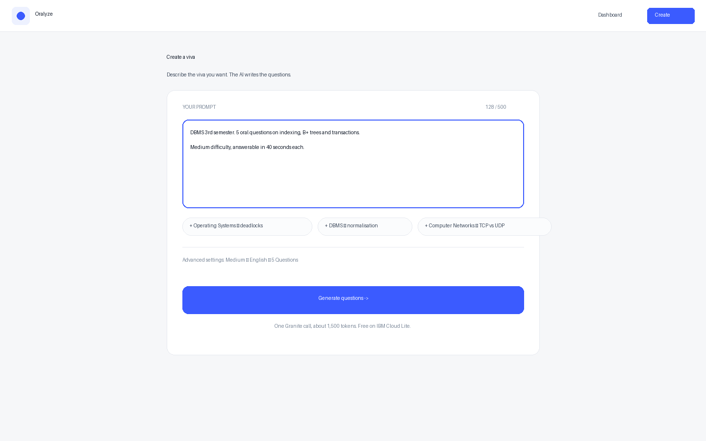
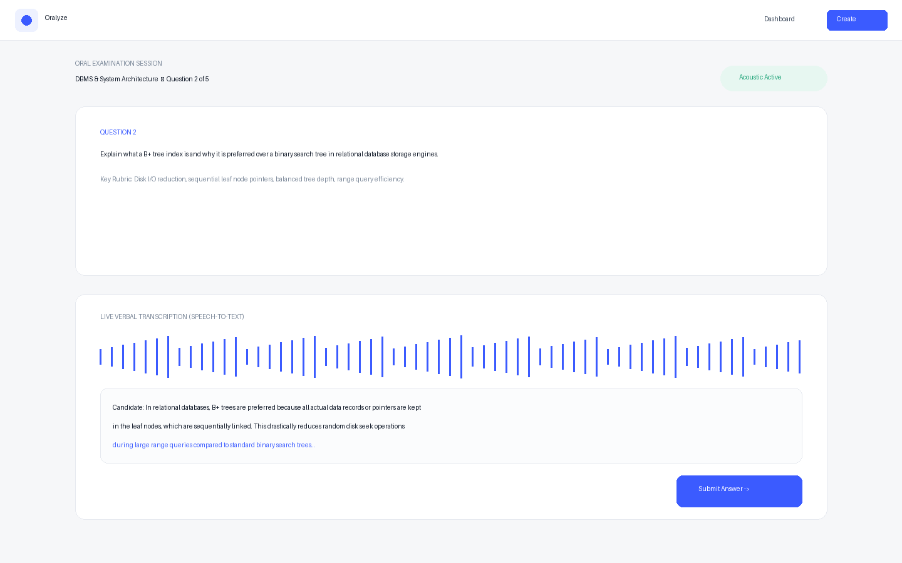
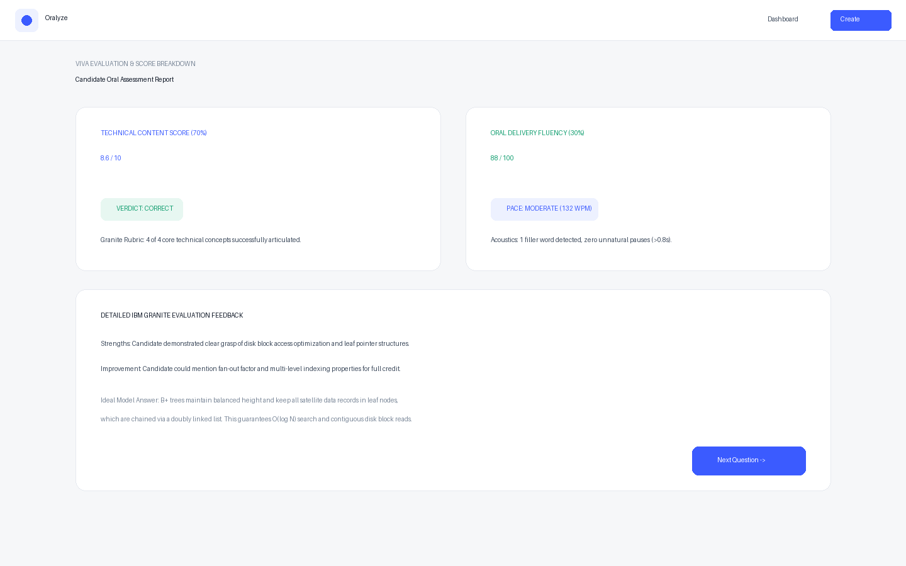
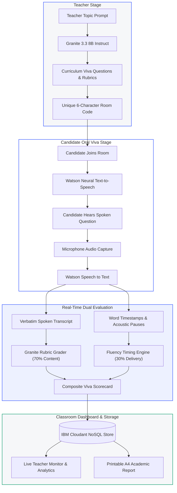
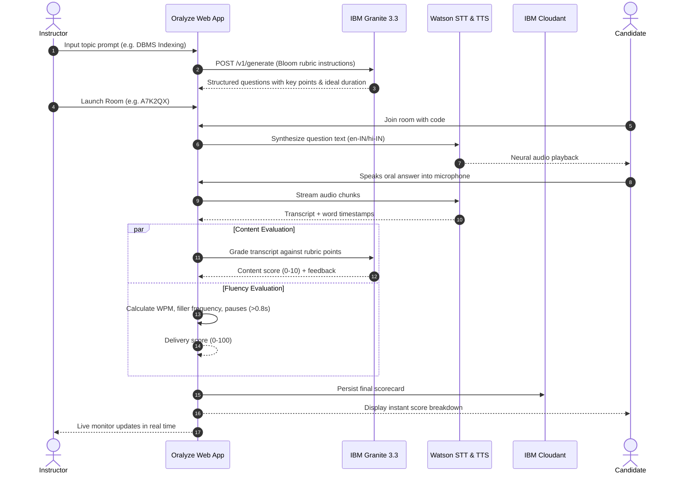

<div align="center">
  
  <h3>AI Voice Viva Voce Examination Platform</h3>
  <p><strong>Powered by IBM Cloud: watsonx Granite 3.3, Watson STT/TTS, and IBM Cloudant</strong></p>
  <p>Generates academic oral viva questions from teacher prompts, speaks questions aloud with neural audio, listens to student responses with live speech-to-text, and grades technical content accuracy alongside oral communication fluency in real time.</p>
</div>

<div align="center">
  <a href="https://mohitraj8503.github.io/Oralyze/"></a>
  
  
  
  
  
</div>

<br />

## Platform Walkthrough

<table align="center" width="100%">
  <tr>
    <td width="50%" align="center">
      <a href="docs/screenshots/01-teacher-setup.png"></a>
      <p><strong>1. Teacher Prompt & Question Generation</strong><br /><em>Teacher inputs topic prompt; Granite 3.3 writes rubric-grounded oral questions.</em></p>
    </td>
    <td width="50%" align="center">
      <a href="docs/screenshots/02-desktop-live-viva.png"></a>
      <p><strong>2. Live Audio Viva & Real-Time Transcript</strong><br /><em>TTS speaks questions; microphone captures speech with live acoustic waveform.</em></p>
    </td>
  </tr>
  <tr>
    <td width="50%" align="center">
      <a href="docs/screenshots/03-desktop-evaluation.png"></a>
      <p><strong>3. Content (70%) & Delivery (30%) Scoring</strong><br /><em>Granite scores technical accuracy; timing engine grades speaking pace and pauses.</em></p>
    </td>
    <td width="50%" align="center">
      <a href="docs/screenshots/04-dashboard.png"></a>
      <p><strong>4. Classroom Analytics & Scorecards</strong><br /><em>Instructor dashboard with aggregated session performance and printable A4 reports.</em></p>
    </td>
  </tr>
</table>

## What it does

- Synthesizes curriculum-grounded viva questions across any engineering discipline.
- Delivers spoken questions to candidates via neural text-to-speech audio.
- Transcribes student spoken answers in real time with word timestamps.
- Produces split scoring for technical correctness (70%) and oral fluency (30%).

## How it works & Architecture

Oralyze coordinates generative artificial intelligence, neural acoustics, and real-time audio analytics:



### Detailed Evaluation Dataflow



## Try it

### Hosted offline demo

You can try the zero-configuration browser edition on GitHub Pages:
https://mohitraj8503.github.io/Oralyze/

The static hosted edition runs completely client-side with no API keys, utilizing browser Web Speech synthesis, speech recognition, and an offline rubric question bank.

### Local development with live IBM backend

Clone the repository and install the minimal dependencies:

```bash
git clone https://github.com/mohitraj8503/Oralyze.git
cd Oralyze
pip install -r requirements.txt
cp .env.example .env
```

Configure your credentials in `.env`:

```bash
IBM_API_KEY=your_ibm_cloud_api_key
WATSONX_PROJECT_ID=your_watsonx_project_id
TTS_URL=https://api.us-south.text-to-speech.watson.cloud.ibm.com/instances/...
STT_URL=https://api.us-south.speech-to-text.watson.cloud.ibm.com/instances/...
CLOUDANT_URL=https://...-bluemix.cloudantnosqldb.appdomain.cloud
MOCK_MODE=0
```

Start the application:

```bash
python app.py
```

Then navigate to `http://localhost:5000` in your web browser.

## Environment variables

| Variable | Description | Source | Required |
| :--- | :--- | :--- | :--- |
| `IBM_API_KEY` | Unified IBM Cloud IAM API Key | IBM Cloud Manage -> Access (IAM) -> API keys | Yes (for live mode) |
| `WATSONX_PROJECT_ID` | watsonx.ai Project GUID | watsonx project Manage -> General tab | Yes (for live mode) |
| `TTS_URL` | Watson Text to Speech service URL | Watson TTS resource details page | Optional (falls back to mock audio) |
| `STT_URL` | Watson Speech to Text service URL | Watson STT resource details page | Optional (falls back to browser Web Speech) |
| `CLOUDANT_URL` | IBM Cloudant service URL | Cloudant resource Service credentials | Optional (falls back to local JSON store) |
| `MOCK_MODE` | Set to 1 for zero-network offline mode | Local environment flag | No (default: 1 if keys missing) |

## IBM Cloud setup

1. Create a free IBM Cloud Lite account at cloud.ibm.com.
2. In the Resource List, create a watsonx.ai project in the Dallas (`us-south`) region.
3. Provision Watson Text to Speech on the Lite tier.
4. Provision Watson Speech to Text on the Lite tier.
5. Provision IBM Cloudant on the Lite tier (select IAM authentication).
6. Create an IBM Cloud IAM API Key under Manage -> Access (IAM) -> API Keys.
7. Paste the API key, project ID, and service URLs into `.env`.

## Free tier limits

| Service | Lite Tier Monthly Quota | Fallback Behavior on Depletion |
| :--- | :--- | :--- |
| IBM Granite 3.3 (watsonx.ai) | 300,000 tokens | Falls back to local question bank and keyword grader |
| Watson Speech to Text | 500 audio minutes | Falls back to browser Web Speech recognition |
| Watson Text to Speech | 10,000 characters | Falls back to browser speech synthesis audio |
| IBM Cloudant | 1 GB storage, 10 writes/sec | Falls back to local JSON session storage |

## Scoring methodology

Oralyze computes a composite grade out of 100 based on a weighted 70/30 split between content accuracy and delivery fluency.

**Content Accuracy (70% weight)**: Granite evaluates the student's transcript against Bloom-taxonomy rubric points. The model awards points for core principles explained, flags omissions, and returns a 0 to 10 score with qualitative feedback.

**Oral Delivery (30% weight)**: Evaluates speech rate against an optimal conversational band (110 to 165 words per minute), penalizes frequent filler words (`um`, `uh`, `basically`, `like`), and counts unnatural hesitation pauses exceeding 0.8 seconds.

## Project structure

```text
Oralyze/
├── .github/workflows/pages.yml # Automated GitHub Pages deployment pipeline
├── app.py                      # Flask backend and REST API endpoints
├── config.py                   # Environment configuration and key validation
├── config.js                   # Client base URL configuration
├── data/
│   └── questions.json          # Bundled question bank for offline evaluation
├── docs/
│   ├── screenshots/            # High-resolution desktop UI walkthrough images
│   └── social-preview.png      # Repository social preview card
├── services/
│   ├── fluency.py              # Speaking rate, pause, and filler analytics
│   ├── granite.py              # Granite prompt generation and rubric grading
│   ├── ibm_auth.py             # IAM token exchange and cache management
│   ├── speech.py               # Raw REST Watson STT and TTS integrations
│   └── store.py                # Cloudant NoSQL and local JSON persistence
├── static/
│   ├── 404.html                # GitHub Pages SPA hash redirector
│   ├── config.js               # Client runtime configuration
│   ├── index.html              # Unified responsive single-page application
│   ├── assets/                 # Vector SVG logos and marks
│   ├── brand/                  # Application brand identity assets
│   ├── data/                   # Client offline dataset copy
│   └── js/
│       ├── api.js              # Unified data abstraction layer
│       └── grader.js           # Browser keyword-overlap grading engine
└── tests/
    └── test_fluency.py         # Unit tests for fluency metrics
```

## Roadmap

- [ ] Support custom rubric upload via CSV/PDF course syllabus.
- [ ] Multi-turn follow-up inquiries when a student's answer is partially complete.
- [ ] WebRTC peer-to-peer classroom room broadcasting.

## Credits

- IBM Cloud Lite Services: watsonx.ai, Watson Speech to Text, Watson Text to Speech, and IBM Cloudant.
- Design foundations adapted from Tailwind CSS and modern Webflow layout tokens.

## License

This project is licensed under the [MIT License](LICENSE).
